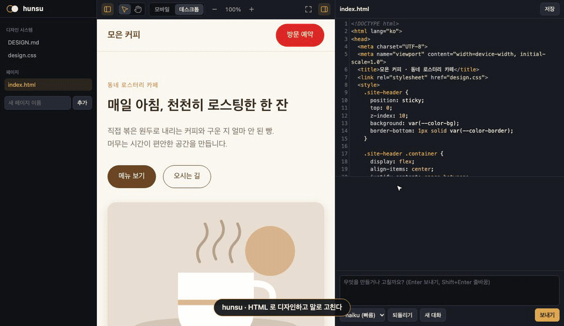
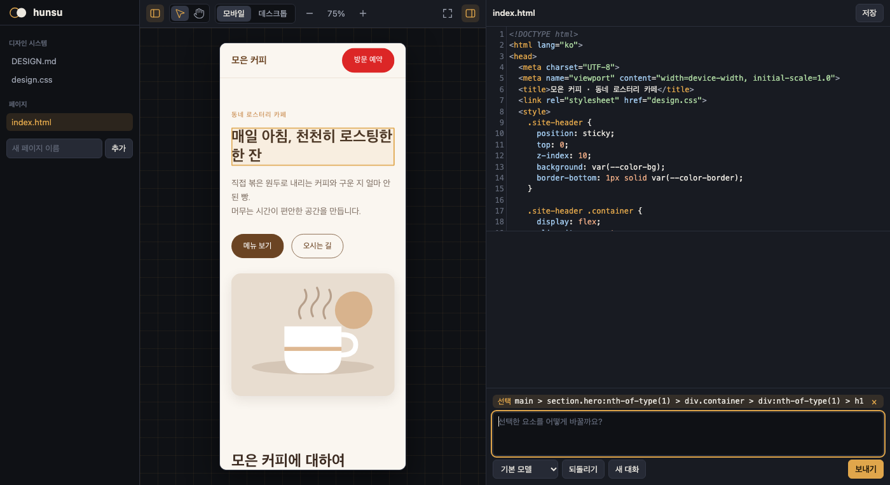

# hunsu

한국어 | [English](README.en.md)

HTML 로 디자인하는 로컬 디자인 도구. 렌더 화면을 보며 원본을 고치거나, LLM 에게 말로 고치게 한다.



- **말로 만들고 고치기**: 빈 폴더에서 페이지와 디자인 시스템을 만들고, "이 버튼 더 크게" 처럼 고친다.
- **요소 선택**: 렌더 화면에서 클릭해 "이거" 를 지정하고, 더블클릭해 문구를 바로 고친다.
- **디자인 시스템**: `DESIGN.md`(규칙)와 `design.css`(값)를 모든 페이지와 LLM 이 공유한다.
- **에셋**: 이미지·폰트를 끌어다 놓으면 LLM 이 페이지에 쓴다.
- **외부 에이전트 (MCP)**: Claude Code, Codex 같은 MCP 클라이언트가 선택한 요소를 알고 직접 고친다.
- **되돌리기·버전**: 요청 하나를 통째로 되돌리고, 썸네일이 붙은 버전으로 언제든 돌아간다.
- **내보내기**: 폴더 ZIP, 페이지별 HTML 파일 하나, PNG.
- **비교안**: 한 요청으로 2~3안을 동시에 만들어 나란히 보고 고른다.

## 요구 사항

- macOS
- 브라우저 채팅의 LLM: [Claude Code](https://claude.com/claude-code) CLI(`claude`) 또는 [Codex](https://github.com/openai/codex) CLI(`codex`), 로그인 상태
- Chrome (선택): LLM 이 렌더 결과를 보고 확인한다. Chromium·Edge·Brave 도 된다. 없으면 이 기능만 꺼진다
- Go 1.27+: 소스로 빌드할 때만

## 설치

```bash
brew install zzzinho/hunsu/hunsu
```

소스로 빌드하려면 Go 1.27+ 로 `go build -o hunsu .`.

## 실행

```bash
hunsu ~/designs      # 생략하면 현재 디렉터리
```

`http://127.0.0.1:7777` 에 뜨고 브라우저가 열린다. `-port 8888` 로 포트 변경, `-no-open` 으로 브라우저 열기 생략. `-provider codex` 로 LLM 을 고른다(생략하면 설치된 것을 claude → codex 순으로). 설치·로그인이 안 됐으면 터미널과 채팅 창에 실행할 명령을 알린다.

## 사용법



화면은 파일 / 렌더 / 편집기·채팅 패널로 나뉜다. 경계를 끌어 크기를 바꾸고(더블클릭은 기본 크기), 막대 버튼으로 접는다. 화면 문구는 영어가 기본이고, 파일 패널 위 언어 메뉴에서 한국어를 고르면 기억한다. 아래 버튼 이름은 한국어 화면 기준이다.

**채팅**

- "카페 랜딩 페이지 만들어줘", "메뉴 페이지도 같은 디자인으로", "모든 페이지 버튼을 둥글게" 처럼 요청한다. 새로 만든 페이지는 자동으로 열린다.
- 진행이 "index.html 쓰는 중 · 12.4KB · 23초" 처럼 보인다. 실행 중에는 [보내기] 가 [취소] 가 된다.
- 대화는 프로젝트마다 이어진다. [새 대화] 로 새로 시작한다.
- [2안 비교]·[3안 비교] 를 고르고 보내면 안마다 다른 방향(충실하게·과감하게·절제해서)으로 동시에 만든다. 나란히 보고 [이 안 고르기] 를 누르면 그 안이 지금 상태가 되고, 나머지 안도 버전에 남는다. 원본은 고를 때까지 그대로다.
- [되돌리기] 는 직전 요청 전으로 돌린다. 반복하면 더 이전으로.
- [버전] 은 요청이 끝날 때마다 남는 버전을 썸네일과 함께 보여준다. 아무 버전으로 복원하고, 복원도 [되돌리기] 로 취소할 수 있다. [지금 상태 저장] 으로 직접 남긴다. 최근 100개.
- 모델은 provider 가 정한다. claude provider 는 opus 기본, sonnet·haiku 선택. 새 페이지는 opus 약 1분 40초, haiku 약 30초.

**요소 선택**

선택 도구(V)로 요소를 클릭하면 입력창 위에 선택 칩이 붙는다. "이거 빨간색으로" 처럼 요청한다. 페이지가 바뀌어도 선택은 유지되고, Esc 나 × 로 해제한다.

| 도구 | 동작 |
|---|---|
| 선택 (V) | 클릭으로 요소 선택, 더블클릭으로 문구 수정. 링크·버튼은 동작하지 않는다 |
| 손 (H) | 끌어서 페이지 안 이동. 끌지 않은 클릭은 그대로 동작 |
| 모바일 / 데스크톱 | 390px / 렌더 영역 전체 너비 |
| − 100% + | 25~300% 확대/축소 |

**문구 직접 수정**

텍스트만 가진 요소(제목, 버튼, 링크 등)를 더블클릭해 고친다. Enter 나 바깥 클릭으로 원본에 저장하고, Esc 로 취소한다. 페이지 JS 가 만든 문구처럼 원본에서 찾지 못하면 저장하지 않고 알린다. 편집기 저장처럼 [되돌리기] 대상은 아니다.

**디자인 시스템**

| 파일 | 내용 |
|---|---|
| `design.css` | CSS 변수와 공통 클래스. 모든 페이지가 링크한다 |
| `DESIGN.md` | 글로 쓴 규칙. LLM 이 따른다 |

파일 패널 맨 위에 있고, 없으면 눌러서 만든다. 대화의 첫 요청과 내용이 바뀔 때 LLM 에게 전달된다.

**에셋**

이미지(png·jpg·gif·webp·avif·svg)·폰트(woff·woff2·ttf·otf)를 화면에 끌어다 놓거나 [이미지·폰트 올리기] 로 고르면 `assets/` 에 저장된다. 파일당 10MB, 같은 이름은 거부한다. 목록은 요청마다 LLM 에게 전달된다. 되돌리기 대상이 아니며, 지우기는 Finder 에서 한다.

**내보내기**

화면 막대의 [내보내기] 에서 받는다.

| 항목 | 내용 |
|---|---|
| 이 페이지 · HTML 파일 하나 | `design.css` 와 에셋을 넣은 HTML. 어디서 열어도 같다 |
| 이 페이지 · PNG | 보고 있는 너비(모바일 390px, 데스크톱 1280px)로 전체 페이지. Chrome 필요 |
| 전체 폴더 · ZIP | 디자인 시스템, 페이지, 에셋 (`.hunsu/` 제외) |

**직접 편집**: 에디터에서 고치고 ⌘S. 다른 에디터로 고쳐도 0.5초 안에 반영되고, 다음 요청 때 LLM 에게 알린다.

## 외부 에이전트 (MCP)

hunsu 는 표준 MCP(Streamable HTTP) 서버를 연다. 에이전트가 브라우저 상태를 읽고 파일을 직접 고치면, hunsu 가 바로 다시 그린다.

1. 실행하면 MCP 주소와 토큰이 출력된다: `http://127.0.0.1:7777/mcp`, `Authorization: Bearer <토큰>`
2. MCP 클라이언트에 한 번 등록한다. Claude Code 예:
   ```bash
   claude mcp add --transport http -s user hunsu http://127.0.0.1:7777/mcp -H "Authorization: Bearer <토큰>"
   ```
3. 디자인 폴더에서 에이전트에게 요청한다: "hunsu 에서 선택한 요소를 빨간색으로 바꾸고, about 페이지를 만들어 열어줘"

| 도구 | 동작 |
|---|---|
| `get_context` | 폴더 경로, 페이지, 에셋, 디자인 시스템, 보이는 페이지, 선택한 요소 |
| `checkpoint` | 고치기 전 저장. 브라우저 [되돌리기] 로 복원 가능 |
| `undo` | 마지막 checkpoint 로 복원 |
| `open_page` | 브라우저에 페이지 열기 |
| `screenshot` | 페이지를 렌더한 이미지 (Chrome 이 있을 때) |

토큰은 `~/Library/Application Support/hunsu/mcp-token`(0600)에 한 번 만들어 재사용한다.

## 단축키

| 키 | 동작 |
|---|---|
| V / H | 선택 / 손 |
| Esc | 선택 해제 |
| ⌘+ / ⌘− / ⌘0, 핀치 | 확대 / 축소 / 100% |
| ⌘\\ | 렌더만 보기 |
| ⌘S | 저장 |
| Enter / Shift+Enter | 보내기 / 줄바꿈 |

## 디자인 폴더

```
designs/
  DESIGN.md, design.css   # 디자인 시스템
  *.html                  # 페이지 (루트의 .html 만)
  assets/                 # 이미지·폰트
  .hunsu/                 # 대화 ID, 되돌리기 스냅샷, 버전
```

페이지는 CSS·JS 를 인라인으로 쓰고 `design.css` 와 에셋만 링크한다.

## LLM provider

브라우저 채팅의 LLM 은 `llm.Provider` 인터페이스 뒤에 있다. provider 는 `main.go` 에서만 고르고, Anthropic API 등은 이 인터페이스를 구현해 추가한다 ([`PLAN.md`](PLAN.md) 5).

Chrome 이 있으면 provider 에게 `screenshot` 도구만 둔 MCP 서버(`/mcp/render`)를 건넨다. LLM 은 새 페이지를 만들었거나 크게 바꾼 뒤 스스로 렌더 결과를 보고 고친다.

| provider | 실행 | 격리 | 모델 |
|---|---|---|---|
| claude | 요청마다 `claude -p` | 사용자 설정·hook·MCP 를 섞지 않고, 명령 실행 없이 폴더 안 파일만 다룬다 | opus(기본)·sonnet·haiku. 작은 수정은 haiku 로 1센트 미만 |
| codex | 요청마다 `codex exec` | 사용자 config·규칙·프로젝트 AGENTS.md 를 섞지 않고, 쓰기는 폴더로 한정된 샌드박스에서 명령을 실행한다. 전역 `~/.codex/AGENTS.md` 는 들어간다 | gpt-5.6-sol(기본)·terra·luna. 작은 수정은 luna 로 약 14초 |

측정값은 [`PLAN.md`](PLAN.md) 11.

## 개발

```bash
go test ./... && node --test web/
```

릴리스: `v*` 태그를 push 하면 GitHub Actions 가 universal 바이너리를 Release 에 올린다. `HOMEBREW_TAP_TOKEN` 비밀값이 있으면 `<owner>/homebrew-hunsu` 의 formula 도 갱신한다.

| 경로 | 책임 |
|---|---|
| `main.go` | 조립: 실행 인자, provider 선택, 서버 시작 |
| `internal/project` | 디자인 폴더 접근, 폴더 밖 차단, 에셋, 템플릿, 디자인 규칙 |
| `internal/watch` | 파일 변경 감지 |
| `internal/llm` | provider 계약 |
| `internal/claude`, `internal/codex` | provider (`claude -p`, `codex exec`) |
| `internal/history` | 스냅샷과 되돌리기 |
| `internal/render` | headless Chrome 스크린샷 |
| `internal/export` | ZIP, 단일 HTML 내보내기 |
| `internal/chat` | 요청 처리: 동시 실행 막기, 프롬프트 조립, 대화 이어가기 |
| `internal/server` | 브라우저용 HTTP API |
| `internal/ui` | 브라우저 화면 상태와 명령 |
| `internal/mcp`, `internal/mcptools` | MCP 서버·인증, hunsu 도구 |
| `web/` | 브라우저 UI (빌드 없는 JS 모듈) |

외부 의존성 없음. 코드 규칙은 [`CLAUDE.md`](CLAUDE.md), 결정과 측정값은 [`PLAN.md`](PLAN.md).

## 한계

- 렌더 화면(iframe)이 hunsu 와 같은 출처라, 디자인 페이지의 JS 는 hunsu API 를 부를 수 있다. 믿을 수 없는 HTML 은 열지 않는다.
- 에이전트가 `open_page` 없이 만든 페이지는 다음 조작 때 목록에 나타난다.
- macOS 만 확인했다. 루트의 `.html` 만 페이지로 다룬다.
- 페이지 JS 가 실행 중에 붙인 클래스·id 가 선택 경로에 들어가면 LLM 수정이 적용되지 않을 수 있다.
